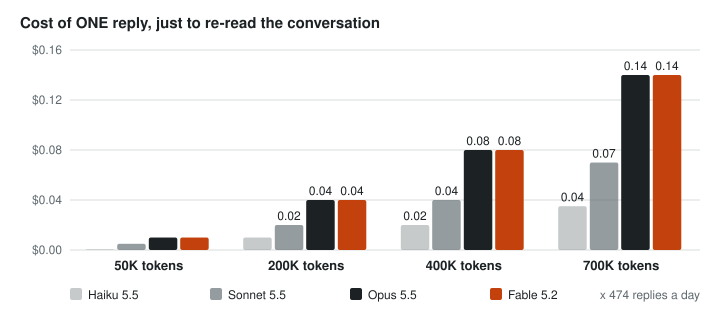
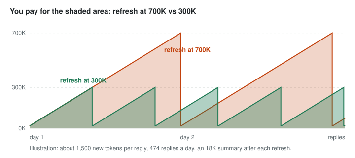
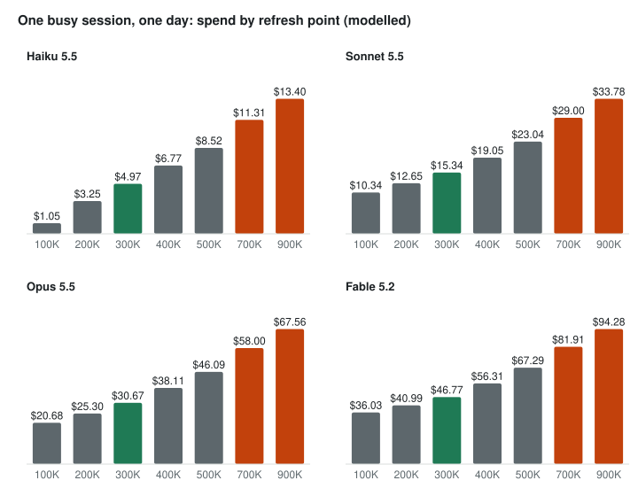
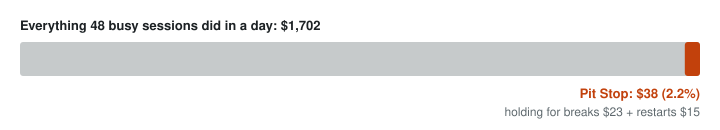

# Windstorm Pit Stop

**A context optimizer for Claude Code, by The Windstorm.**

Free and open source. By [The Windstorm on GitHub](https://github.com/TheWindstorm) (github.com/TheWindstorm). This page: [github.com/TheWindstorm/windstorm-pit-stop](https://github.com/TheWindstorm/windstorm-pit-stop).


A race car never stops mid-corner. It waits for the pit stop, then refuels, changes tires and goes back out. Pit Stop gives Claude Code sessions the same rhythm (the command is `/pit-stop`). At a break between tasks, not in the middle of one, whenever it can, a session:

1. **Refuels.** It compacts its context at a break, at points fitted to that folder's own work.
2. **Changes tires.** It moves onto the newest installed Claude Code. *(Fleet mode, for people who run sessions in tmux.)* Compaction alone never does this: a running session keeps its version until it restarts.
3. **Gets a clean windshield.** The summary is told what to keep, and after every compaction the session gets a short checklist and re-reads only short, relevant instructions and memory that load in full.

The aim: you stop thinking about when to refresh context and which sessions are on an old version.

## Why it pays, in pictures

### 1. Your AI re-reads the whole conversation on every reply

Every time Claude answers, it reads everything said so far in that session. A long session is a backpack that keeps getting heavier, and you pay to carry it on every single step. The price of one reply grows in a straight line with the size of the conversation. Each re-read token is cheap, but there are a lot of them, hundreds of times a day.



*Cached-input price of reading the conversation once, at Anthropic's list API prices. Output and new text come on top.*

### 2. You pay for the shaded area

A session grows as it works. A refresh (Claude Code calls it *compaction*) swaps the long history for a short summary, and the session keeps going. The shaded area is everything you pay to re-read. Refresh at a lower point and the area shrinks.



### 3. The bill, by refresh point and model

One busy session, one day:



The same, per month (modelled; see How these numbers were made):

| Refresh at | Haiku 5.5 | Sonnet 5.5 | Opus 5.5 | Fable 5.2 | Refreshes a day |
|---|---:|---:|---:|---:|---:|
| 100K | $31.50 | $310 | $620 | $1,081 | 8.2 |
| 200K | $97.62 | $380 | $759 | $1,230 | 4.0 |
| **300K** | $149 | $460 | $920 | $1,403 | 2.6 |
| 400K | $203 | $572 | $1,143 | $1,689 | 1.8 |
| 500K | $256 | $691 | $1,383 | $2,019 | 1.3 |
| 700K | $339 | $870 | $1,740 | $2,457 | 0.8 |
| 900K | $402 | $1,013 | $2,027 | $2,828 | 0.5 |
| **Modelled saving, 300K vs 700K** | **$190** | **$410** | **$820** | **$1,054** | |

Haiku 5.5 charges five times more per token once a prompt passes 100K, which is why its bill jumps after 100K.

### 4. Less baggage, cleaner breaks

- **Old topics get in the way.** When you switch from the login page to the invoice bug, everything about the login page is still in the backpack, and the model has to work around it on every reply. A refresh between tasks leaves a short summary and a clear head.
- **Bad timing loses the thread.** Without Pit Stop, Claude Code refreshes the moment a size is reached, even in the middle of a task, and the summary cuts a task in half. Pit Stop waits for the break. On the machine we measured, it moved 34 refreshes off the middle of work in one day.

### 5. Pit Stop's own cost: about 2% on the day we measured

Waiting for a break means a session sometimes works a few extra minutes at a larger size, and a restart onto a new Claude Code rebuilds its cache once. We measured both over a day:



Everything Pit Stop decides is plain code on your computer. It never calls an AI model to decide anything.

### 6. Why not refresh at 100K, then?

After a refresh, a session sometimes has to open files again that it just forgot. Refresh too often and that re-reading, and the mistakes from lost detail, eat the savings. The right point is different for every project. Pit Stop's tuner reads each project's own history, counts how often it had to re-read after a refresh, and moves its refresh point one step at a time: lower while nothing is lost, back up when it is.

**How these numbers were made.** One real day (22,750 replies from 48 busy Claude Code sessions on one machine) replayed at each refresh point and priced at Anthropic's list API prices as published on November 3, 2026 (cached reads, cache writes and output). The cost of re-reading forgotten files is not in this model, so treat the low end as optimistic. On a Claude subscription you are not billed per token, but the same tokens count against your usage limits.

Pit Stop is an independent plugin. It is not made or endorsed by Anthropic. Claude, Claude Code and the model names are Anthropic's.

## Install

Pit Stop lives here, in The Windstorm's GitHub organization ([github.com/TheWindstorm](https://github.com/TheWindstorm)). You don't have to download anything from this page yourself: step 1 points Claude Code at it.

It takes about a minute. You type three short commands, **one at a time**, into Claude Code itself (the box where you talk to Claude), not into a separate terminal window. Paste them one at a time: pasted together they arrive as one message and do not run as three commands.

**Step 1.** Open Claude Code. Copy this line (each box below has a copy button at its top right), paste it into Claude Code and press Enter. It tells Claude Code where to find Pit Stop.

```text
/plugin marketplace add TheWindstorm/windstorm-pit-stop
```

**Step 2.** When step 1 has finished, copy this line, paste it and press Enter. It installs Pit Stop. If Claude Code asks you to confirm, say yes.

```text
/plugin install windstorm-pit-stop@thewindstorm
```

**Step 3.** Copy this line, paste it and press Enter. It sets Pit Stop up for your projects. It shows a plan first and changes nothing until you say yes. It switches weekly tuning on, fits every running session's folder now, and (if you use tmux) offers fleet mode.

```text
/pit-stop setup
```

If Claude Code says it does not know `/pit-stop`, type `/reload-plugins` and press Enter (or close Claude Code and open it again), then do step 3 again.

**Prefer your computer's terminal?** Steps 1 and 2 also work there, outside Claude Code, as two commands (one at a time). Then open Claude Code for step 3.

```bash
claude plugin marketplace add TheWindstorm/windstorm-pit-stop
```

```bash
claude plugin install windstorm-pit-stop@thewindstorm
```

Requirements: Claude Code, plus Python 3.10+ (standard library only) as `python3`, or as `python` where `python3` is not a real interpreter (Windows, where `python3` can be the Microsoft Store stub: the hooks then run `python`). The hook commands need a POSIX shell, which Claude Code uses on macOS, Linux and Windows with Git Bash. Fleet mode needs tmux on Linux or macOS, and Claude Code's `/restart`, which needs the native macOS or Linux install (not WSL or Windows) and a paid Claude plan.

## Two points, not one

Claude Code compacts in two ways, and Pit Stop sets a point for each:

| Point | What happens there | Setting |
|---|---|---|
| **Idle point** | A session that has gone quiet compacts by itself, shortly before its prompt cache expires (about 55 minutes with the 1-hour cache), if its context is at least this big. This is the pit stop at a break. Claude Code's default is 200K and it never goes under 100K. | `CLAUDE_CODE_IDLE_COMPACT_MIN_TOKENS` |
| **Window** | The hard point, for a session that never goes quiet. Above it, Claude Code wants to compact at once; Pit Stop's hook holds that until the next break, up to a ceiling. | `CLAUDE_CODE_AUTO_COMPACT_WINDOW` |

So a session set to 200K / 500K compacts at 200K or more when it gets a quiet hour, and at about 500K if it never does: a little past 500K if it is mid-task, at the next break.

**When Claude Code prepares the summary early.** Claude Code can write the summary ahead of time, in the background: it asks the hook at about 82% of the window, and when the window is reached it swaps the finished summary in within milliseconds, keeping the newest messages word for word. That swap can land in the middle of a tool call and the hook is not asked again. So with this on, Pit Stop's hold decides where the summary *ends* (at a break, so the summary covers finished steps), and the swap itself costs no wait. Whether it is on is Anthropic's rollout and the `precomputeCompactionEnabled` setting; on the fleet this was measured on, 96 of 537 automatic compactions in a week were swaps of this kind. `/pit-stop optimize` counts them separately.

## What you get

| Part | What it does | On by default? |
|---|---|---|
| **Compact at a break** (hook) | Holds *automatic* compaction while a tool call is in flight, and lets it run at the next break. Once a hold has used half of its room, a `git commit` or `git push` that just finished also counts as a break (for turns that run for hours and never reach one). It always allows a manual `/compact`, anything at or above a hard ceiling, and any error case. | Yes, when the plugin is enabled |
| **Keep-list for the summary** (hook) | When an automatic compaction goes ahead, tells the summary what to keep: the task in progress and its next step, open to-dos, background jobs and how to start them again, files being changed, decisions. You can add a note of your own or switch it off. | Yes |
| **Checklist after a compaction** (hook) | Three lines added to the session's context: check your background jobs, re-read only what the next step needs, say so if the next step is unclear. | Yes |
| **Update line** (hook) | When a newer Claude Code is installed than a session runs, you see one line, once per version: type `/restart` at a break. Claude does not see it and no turn starts. Silent when fleet mode is running. | Yes |
| **`/pit-stop setup`** | One command: weekly tuning on, every running session's folder fitted now, and fleet mode if you want it. | You run it once |
| **`/pit-stop optimize`** | Reads a folder's own session history and recommends its idle point, window and ceiling, with the reasons. It also suggests (never applies) a model and effort level. `--lanes` works out each session of a shared folder by itself. | You run it, or weekly tuning does |
| **Weekly tuning** | Once a week per folder, in the background, moves each point at most one step toward what the last two weeks of history say. It runs when a session starts in the folder; in fleet mode the helper also does it for every running session's folder, one at a time, when the machine is not busy. | Off until `/pit-stop setup` |
| **`/pit-stop reading`** | Checks the instruction files and memory index a folder's sessions re-read. Claude Code loads only the first **200 lines or about 24 KB** of `MEMORY.md`, whichever comes first, so an index that grows past that silently drops its newest entries. It trims without deleting anything. | You run it |
| **`/pit-stop status`** | The short list of what needs a person: sessions that have had a question on screen for hours, sessions Pit Stop cannot update and why, sessions that never loaded its hooks. In fleet mode it is also kept in `~/.claude/pit-stop/needs-you.md`, and your `notify_command` hears when it changes. |
| **`/pit-stop report`** | One read-only line per running session: version vs newest, state, idle point, window, memory size. | You run it |
| **The pit stop** (fleet mode) | For tmux users with many sessions. At a break it moves each session onto the newest Claude Code, one at a time: a big session whose cache is still warm is compacted first and restarted after; a small one, or one idle so long its cache is cold, is restarted directly. Sessions with background jobs are asked to sort them first. Every skip is logged with its reason. | Off; dry run unless `--live` |

## How the optimizer decides

It reads the folder's transcripts and keeps counts only; message text is never printed or sent anywhere.

| Signal | What it suggests |
|---|---|
| Cold wake-ups (a prompt after an hour or more of quiet finds the prompt cache gone, so the whole context is paid for again) | The biggest cost of a long context: a lower idle point |
| Topic change (how much of the set of folders in play is new from one stretch of work to the next) | Old context is mostly noise: lower points |
| Files re-read right after a compaction that were already read before it | The point was too early: compact later |
| Almost no re-reading after compactions | Compacting loses little here: an earlier idle pit stop is cheap |
| The same folders for long stretches, with some re-reading | Long, connected work: keep more |
| Mostly reading and coordinating | Long threads benefit from more history |
| Mostly editing | Fresh context after each task usually helps |
| **Usage**: how many tokens the folder's busiest session reads from the cache each day | Almost all of a long session's usage is its context being read again on every model call. A folder that reads a lot gets a lower window (see the budget below) |
| Tool error rate, work mix | Model and effort *suggestions* for a person to decide |

It also reports when the folder's compactions happened: while idle, as a prompt arrived, or mid-task.

A rule of thumb that surprised us: "it does the same thing over and over, so it can run long" is not what the history shows. What costs most is how often a session wakes up cold. A session that repeats one job and never looks back after a compaction can run *low* and lose nothing; the ones worth a high point do long, connected work and keep re-reading files after each compaction.

**The usage budget.** One word in `~/.claude/pit-stop/config.json` (`"budget"`), or `/pit-stop setup --budget ...`, says how hard tuning holds usage down:

| Budget | What it does |
|---|---|
| `roomy` | Tunes for memory only (what 0.2.x did). |
| `balanced` (default) | A heavy folder (its busiest session reads 100M+ tokens a day from the cache) is capped at a 500K window, a very heavy one (250M+) at 400K, and neither is raised above where it is now. Everything else is tuned for memory. |
| `economy` | Every folder is capped at 400K, a heavy one at 300K, and no window is raised. |

A folder whose sessions re-read a lot after compacting (30% or more) gets one step more in any budget, because compacting it harder would cost reads of its own. The optimizer prints an estimate of the reads saved; it is rough (the average context is taken as halfway between what a summary keeps and the window). On the 95-session machine this was built on, the estimate was 11% fewer cache reads under `balanced` and 32% under `economy`, against 7% for `roomy`.

The two points are written to the folder's `.claude/settings.local.json` (under `env`), with a backup first. A profile with the reasons goes to `~/.claude/pit-stop/folders/` (your own folder, never the project). The hook reads its ceiling from there, so a session that is mid-task can run past the window up to the ceiling, but not beyond it. New points take effect at a session's next start; a pit-stop restart counts. To move the window of a running session at once, type `/autocompact <tokens>` in it.

Several sessions in one folder share that folder's settings. `--lanes` also writes a profile per session (`~/.claude/pit-stop/lanes/`); fleet mode can use it for early idle compaction (`idle_compact_after`).

These are heuristics, not guarantees. Model and effort changes affect quality and cost, so Pit Stop only suggests them.

## Fleet mode: what it types, and what it costs

Claude Code accepts `/restart` only when it is typed at the prompt, so fleet mode types into tmux panes. It types three things (and `/reload-plugins`, if you switch that on; see below), each only into an idle session with an empty input box and no dialog:

- `/restart`: free by itself, since no turn starts. A new version does rebuild the prompt cache from the top at the session's next turn, so a restart costs more the bigger the context is. That is why it happens right after a compaction, on a small context, or when the cache has gone cold anyway.
- `/compact`: only for a big session whose cache is still warm (quiet between 5 and 48 minutes with the 1-hour cache), so the summary is read from the cache. The restart follows on the next run. Switch off with `"compact_before_restart": false`.
- One note, in two cases only: a session that stopped its background jobs for the restart is told to start them again; and a session that has not loaded the plugin's hooks yet gets the background-jobs ask typed, while its cache is warm or its context small. No typed note is longer than 560 characters (Claude Code folds longer typed text into a paste block): a list of jobs too long for the note is named by its file instead. After a restart with no jobs to start again, nothing is typed. That includes the hour-idle restart (`cold_idle`): the session comes back on the new version and stays quiet until its next prompt, so no full-context turn is spent.

**The quiet-session pit stop** (`"idle_compact_after": 2400`, off by default). A session that has been quiet that many seconds, over its idle point, with its cache still warm, gets `/compact` typed, so its next wake-up does not write the whole context to the cache again. Claude Code does this by itself shortly before the cache expires, but on the machine this was measured on it reached only about a third of the big quiet sessions: in 7 days, 422 wake-ups of 200K or more paid for the whole context again. Since 0.3.0 it also covers sessions with background jobs (a compaction does not need them stopped) and sessions behind the newest version, and it uses Claude Code's 200K default where no idle point has been tuned.

**Sessions whose hooks are missing or wrong** (`"reload_plugins": true`, off by default). A session loads a plugin's hooks when its process starts, and a session already on the newest Claude Code is never restarted. So a session that started before Pit Stop was installed has no hook at all, and one that loaded an older release keeps that release's hooks. The helper types `/reload-plugins` (a local command, no turn starts) only where that matters: the session has no Pit Stop hook; or the version folder its hooks run from is gone; or the plugin's hook generation (`hooks/generation.json`, raised only when a running session must reload) differs from the installed one. Merely older is left alone. It is typed at a break, right after a compaction, on a small context, or once the cache is cold, because a reload can make the session's next turn write its context to the cache again; a big session with a warm cache waits (`"reload_warm": true` lifts that). `"reload_only_names"` limits it to named sessions for a staged roll-out.

**Background jobs.** Claude Code refuses `/restart` while background work runs. The helper leaves an ask for that session; the plugin's own Stop hook hands it over at the end of the session's next turn. Claude sorts its jobs: watchers it can simply start again are listed and stopped, and the restart follows; if anything is real work in progress, it changes nothing and is asked again in 12 hours. If a session stopped its jobs and no restart came within 30 minutes, it is told to start them again.

Settings live in `~/.claude/pit-stop/restart.json` (see the top of `scripts/restart_at_break.py`): `allow_names`, `deny_names`, `deny_name_globs` (for example `"* Boss"`), `deny_paths`, and the timings. `/pit-stop setup --fleet` never changes an existing file.

## Safety

- **Fails safe.** Every hook allows on any error. The restart helper skips anything it cannot read.
- **Never mid-task.** It never types into a session with text in its input box, a dialog open, or work running, and never restarts one with background jobs it hasn't agreed to stop. Claude Code itself refuses `/restart` while background work runs.
- **Never a cold, costly turn.** Nothing that starts a turn is typed into a big session whose cache has gone cold.
- **Checks before Enter.** After typing, the restart helper presses Enter only if the input box holds exactly what it typed; otherwise it clears the line, skips, and backs off that session.
- **Asks through its own hook.** The background-jobs ask reaches Claude through the plugin's Stop hook, once, and never twice in a row.
- **One step a week.** Weekly tuning moves a point at most one step, and keeps the newest three backups of the settings file.
- **Your folder, not the project's.** Profiles, switches and extra summary notes are read from `~/.claude/pit-stop/` only, so a cloned repo cannot steer the summary. A ceiling from a 0.1.x project file is still read, and clamped.
- **Capped ceilings.** A ceiling from a profile or the environment is clamped to 1.5x the first hold and 95% of the model's context size, so a cloned repo cannot hold compaction until the context overflows.
- **Backups first.** Every file is backed up before it is written. Only the keys Pit Stop owns are changed.
- **Local only.** No network calls. Logs hold counts only and rotate at 5 MB.

`/pit-stop setup --fleet` installs a timer (systemd user timer or launchd) that runs a small launcher every 5 minutes; the launcher finds the installed plugin each run, so the timer keeps working across plugin updates. A timer you wrote yourself that names a version folder stays pinned to that version until you change it. Timers start with a bare PATH: setup puts the folders of `tmux` and `claude` in it. Fleet mode reads Claude Code's local session registry (`~/.claude/sessions/`), which is not a public interface; if that gives nothing usable it falls back to the documented `claude agents --json`.

## Tested

- Hook decisions: mid-action holds, a break allows, a finished commit or push allows once half the hold's room is used (and never before, never when it failed or another call still runs), the ceiling allows, a manual `/compact` allows, bad input allows. A hold prints nothing; an allowed automatic compaction prints only the keep-list.
- The Stop hook hands the background-jobs ask to Claude once, in a real session on Claude Code 2.1.322 (exit 2 passes through the `python3`/`python` probe line).
- The restart plan as a pure function, and the helper in live mode against a faked pane: compact first then restart, cold restart with nothing typed, the ask left for the Stop hook, a late restart still getting its start-your-jobs note, stale lists put away, nothing typed during a typing backoff.
- The helper's dry run against a live fleet of 94 sessions (it types and writes nothing).
- `/restart` on Claude Code 2.1.318 → 2.1.319 keeps the same session id, conversation, model and effort. Scheduled session crons survive. In that test the first turn after the restart read about 47K tokens from cache; do not count on that, since a new version normally rebuilds the cache from the top.
- Live on one real session (Claude Code 2.1.319 → 2.1.322, 111K context, cache warm): `/compact` typed, compacted 39 s later; on the next run `/restart` typed, same session id on the newest version 12 s later, nothing typed after.
- On a real Windows machine (build 26300, Git for Windows 2.52, a standard user, `python` 3.14.2 and `python3` being the Microsoft Store stub): `tests/smoke_hooks.sh` passes every check for 0.2.0 and for 0.1.4. The probe line picks `python`; a hold exits 2 and prints nothing, a break and a manual `/compact` exit 0, no Store-stub text reaches the summary notes, the Stop hook asks once, SessionStart prints its checklist. 0.1.4 passed with LF and with CRLF line endings (that machine's git converts on checkout). The test was started through Git Bash by its full path; it does not prove that Claude Code itself finds Git Bash for a user who has no `bash` on PATH.
- Not yet proven on a real machine: the keep-list's effect on summaries, the Stop-hook ask followed by a restart in a session with real background jobs, and the launchd timer written by `/pit-stop setup`.

Run the tests: `python3 -m pytest tests/`. On any machine, `sh tests/smoke_hooks.sh` runs each hook's real command line in a throwaway folder and says PASS or FAIL per check (it starts no session and installs nothing).

## Credits

The hook and the restart helper were first built by **Windy Boss**, an AI agent in The Windstorm's Windy fleet, on a Mac mini in November 2026. They were then ported to Linux and packaged here.

## License

[Apache License 2.0](LICENSE). "Windstorm Pit Stop" and "The Windstorm" are names of The Windstorm and are not licensed as trademarks; see [NOTICE](NOTICE).
