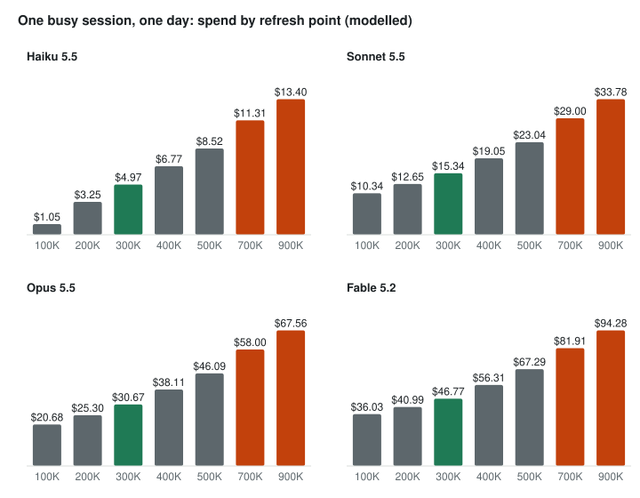

# Windstorm Pit Stop

**A context optimizer for Claude Code, by The Windstorm.**

Free and open source. By [The Windstorm on GitHub](https://github.com/TheWindstorm) (github.com/TheWindstorm). This page: [github.com/TheWindstorm/windstorm-pit-stop](https://github.com/TheWindstorm/windstorm-pit-stop).

More from The Windstorm: [Pit Stop explained](https://thewindstorm.ai/plugins/pit-stop?utm_source=github&utm_medium=referral&utm_campaign=ecosystem) · [thewindstorm.ai](https://thewindstorm.ai) (the podcast) · [grantwhitmer.com](https://grantwhitmer.com) (Grant Whitmer, who built it).


A race car never stops mid-corner. It waits for the pit stop, then refuels, changes tires and goes back out. Pit Stop gives Claude Code sessions the same rhythm (the command is `/pit-stop`). At a break between tasks, not in the middle of one, whenever it can, a session:

1. **Refuels.** It compacts its context at a break, at points fitted to that folder's own work.
2. **Changes tires.** It moves onto the newest installed Claude Code. *(Fleet mode, for people who run sessions in tmux.)* Compaction alone never does this: a running session keeps its version until it restarts.
3. **Gets a clean windshield.** The summary is told what to keep, and after every compaction the session gets a short checklist and re-reads only short, relevant instructions and memory that load in full.

The aim: you stop thinking about when to refresh context and which sessions are on an old version.

## Pit Stop in 30 seconds

- **Long sessions get expensive.** Claude re-reads your whole conversation on every reply. Pit Stop refreshes the session at a break between tasks, so you stop paying to drag a huge history along.
- **It doesn't lose the thread.** It refreshes between tasks, not in the middle of one, whenever it can.
- **It learns each project.** It fits the refresh point of each of your projects to that project's own history.
- **It keeps you current.** It tells you when a newer Claude Code is ready. If you run sessions in tmux on Linux or macOS with a paid Claude plan, it can move them onto it at a break, same conversation.
- **Small overhead.** It is plain code on your computer and never calls an AI to decide anything. On the machine we measured it cost about 2% of the day's usage.
- **What it can save** (modelled from one real day): refreshing at 300K instead of letting a session run to 700K saves about $820 a month per busy session on Opus 5.5, or about $410 on Sonnet 5.5. Details below.

It works with Claude Code only, for now. [Install it](#install) in about a minute.

## Measured on our own fleet

We run Pit Stop on our main machine, where Claude Code sessions work around the clock on many projects (94 today), using between 1.9 and 9.9 billion tokens a day (November 4-12, 2026). For each session we compared its history before Pit Stop's hooks were loaded (from October 26, 2026) with the time after. This is our own machine and our own work, not a controlled trial.

- Automatic refreshes in the middle of a task, counted again on November 20, 2026: 46% before Pit Stop (210 of 453, October 26 to November 10), 19% with it (148 of 762, November 10 to 19). Sessions that ran without it (November 10 to 13): 74% (133 of 180). Refreshes that Claude Code had prepared ahead and swapped in at once (253 with Pit Stop) are counted apart: they cost no wait and no re-reads. Our first count put them among the mid-task refreshes and said 52% before.
- Our first count, November 4 to 12, said 11% with Pit Stop (32 of 291), and it stayed near that (9%) until November 14. It rose on November 15 to 17, days of long tool runs. When a run reaches its folder's ceiling, Pit Stop lets the refresh through in the middle of the task, by design, so the context does not fill up. From November 14 to 19, Pit Stop logged 113 such ceiling releases, against 120 refreshes in the middle of a task.
- After a refresh, sessions re-read files they had just lost less often: 17% of their first file reads before Pit Stop (549 reads), 12% with it (720), and 13% in sessions without it (142); counted after each automatic refresh followed by at least 3 file reads.
- Overnight from November 12 to 13, it moved 86 sessions onto a new Claude Code version at their breaks, with nobody watching.
- Not measured yet: what it saves in practice. The savings above are modelled; they depend on each project's refresh point, which we started tuning for a test group on November 13. The comparison with untouched sessions comes next. Pit Stop's own cost was about 2% on the day we measured.

## Why it pays, in pictures

### 1. Your AI re-reads the whole conversation on every reply

Every time Claude answers, it reads everything said so far in that session. A long session is a backpack that keeps getting heavier, and you pay to carry it on every single step. The price of one reply grows in a straight line with the size of the conversation. Each re-read token is cheap, but there are a lot of them, hundreds of times a day.


*Cached-input price of reading the conversation once, at Anthropic's list API prices. Output and new text come on top.*

### 2. You pay for the shaded area

A session grows as it works. A refresh (Claude Code calls it *compaction*) swaps the long history for a short summary, and the session keeps going. The shaded area is everything you pay to re-read. Refresh at a lower point and the area shrinks.


### 3. The bill, by refresh point and model

One busy session, one day:



The same, per month (modelled; see How these numbers were made):

| Refresh at | Haiku 5.5 | Sonnet 5.5 | Opus 5.5 | Fable 5.2 | Refreshes a day |
|---|---:|---:|---:|---:|---:|
| 100K | $31.50 | $310 | $620 | $1,081 | 8.2 |
| 200K | $97.62 | $380 | $759 | $1,230 | 4.0 |
| **300K** | $149 | $460 | $920 | $1,403 | 2.6 |
| 400K | $203 | $572 | $1,143 | $1,689 | 1.8 |
| 500K | $256 | $691 | $1,383 | $2,019 | 1.3 |
| 700K | $339 | $870 | $1,740 | $2,457 | 0.8 |
| 900K | $402 | $1,013 | $2,027 | $2,828 | 0.5 |
| **Modelled saving, 300K vs 700K** | **$190** | **$410** | **$820** | **$1,054** | |

Haiku 5.5 charges five times more per token once a prompt passes 100K, which is why its bill jumps after 100K.

### 4. Less baggage, cleaner breaks

- **Old topics get in the way.** When you switch from the login page to the invoice bug, everything about the login page is still in the backpack, and the model has to work around it on every reply. A refresh between tasks leaves a short summary and a clear head.
- **Bad timing loses the thread.** Without Pit Stop, Claude Code refreshes the moment a size is reached, even in the middle of a task, and the summary cuts a task in half. Pit Stop waits for the break. On the machine we measured, it moved 34 refreshes off the middle of work in one day.

### 5. Pit Stop's own cost: about 2% on the day we measured

Waiting for a break means a session sometimes works a few extra minutes at a larger size, and a restart onto a new Claude Code rebuilds its cache once. We measured both over a day:


Everything Pit Stop decides is plain code on your computer. It never calls an AI model to decide anything.

### 6. Why not refresh at 100K, then?

After a refresh, a session sometimes has to open files again that it just forgot. Refresh too often and that re-reading, and the mistakes from lost detail, eat the savings. The right point is different for every project. Pit Stop's tuner reads each project's own history, counts how often it had to re-read after a refresh, and moves its refresh point one step at a time: lower while nothing is lost, back up when it is.

**How these numbers were made.** One real day (22,750 replies from 48 busy Claude Code sessions on one machine) replayed at each refresh point and priced at Anthropic's list API prices as published on November 3, 2026 (cached reads, cache writes and output). The cost of re-reading forgotten files is not in this model, so treat the low end as optimistic. On a Claude subscription you are not billed per token, but the same tokens count against your usage limits.

Pit Stop is an independent plugin. It is not made or endorsed by Anthropic. Claude, Claude Code and the model names are Anthropic's.

## Install

Pit Stop lives here, in The Windstorm's GitHub organization ([github.com/TheWindstorm](https://github.com/TheWindstorm)). You don't have to download anything from this page yourself: step 1 points Claude Code at it.

**Easiest: let Claude do it.** Open Claude Code and paste this to it:

```text
Install the Claude Code plugin from https://github.com/TheWindstorm/windstorm-pit-stop using the terminal commands in the Install section of its README, then tell me what to type next.
```

Claude can run the two terminal commands below for you. Then type `/reload-plugins` and `/pit-stop setup` (step 3 below).

**Or do it yourself.** It takes about a minute. You type three short commands, **one at a time**, into Claude Code itself (the box where you talk to Claude), not into a separate terminal window. Paste them one at a time: pasted together they arrive as one message and do not run as three commands.

**Step 1.** Open Claude Code. Copy this line (each box below has a copy button at its top right), paste it into Claude Code and press Enter. It tells Claude Code where to find Pit Stop.

```text
/plugin marketplace add TheWindstorm/windstorm-pit-stop
```

**Step 2.** When step 1 has finished, copy this line, paste it and press Enter. It installs Pit Stop. If Claude Code asks you to confirm, say yes.

```text
/plugin install windstorm-pit-stop@thewindstorm
```

Steps 1 and 2 were seen to work with no GitHub key and no sign-in on Claude Code 2.1.280 (Linux) and 2.1.330 (Linux and macOS); every entry in the catalog is fetched over https.

**Step 3.** Copy this line, paste it and press Enter. It sets Pit Stop up for your projects. It shows a plan first and changes nothing until you say yes. It switches daily tuning on, fits every running session's folder now, and (if you use tmux) offers fleet mode.

```text
/pit-stop setup
```

If Claude Code says it does not know `/pit-stop`, type `/reload-plugins` and press Enter (or close Claude Code and open it again), then do step 3 again.

**Prefer your computer's terminal?** Steps 1 and 2 also work there, outside Claude Code, as two commands (one at a time). Then open Claude Code for step 3.

```bash
claude plugin marketplace add TheWindstorm/windstorm-pit-stop
```

```bash
claude plugin install windstorm-pit-stop@thewindstorm
```

Requirements: Claude Code, plus Python 3.10+ (standard library only) as `python3`, or as `python` where `python3` is not a real interpreter (Windows, where `python3` can be the Microsoft Store stub: the hooks then run `python`). The hook commands need a POSIX shell, which Claude Code uses on macOS, Linux and Windows with Git Bash. Fleet mode needs tmux on Linux or macOS, and Claude Code's `/restart`, which needs the native macOS or Linux install (not WSL or Windows) and a paid Claude plan.

## Two points, not one

Claude Code compacts in two ways, and Pit Stop sets a point for each:

| Point | What happens there | Setting |
|---|---|---|
| **Idle point** | A session that has gone quiet compacts by itself, shortly before its prompt cache expires (about 55 minutes with the 1-hour cache), if its context is at least this big. This is the pit stop at a break. Claude Code's default is 200K and it never goes under 100K. | `CLAUDE_CODE_IDLE_COMPACT_MIN_TOKENS` |
| **Window** | The hard point, for a session that never goes quiet. Claude Code asks to compact a little before the context reaches it (seen once, November 22, 2026, on Claude Code 2.1.330: at 108K with a 23K file read about to be added, at a 150K window); Pit Stop's hook holds that until the next break, up to a ceiling. | `CLAUDE_CODE_AUTO_COMPACT_WINDOW` |

So a session set to 200K / 500K compacts at 200K or more when it gets a quiet hour, and, if it never does, Claude Code asks a little before 500K; if the session is in the middle of a task, Pit Stop holds that to the next break, which can be a little past 500K, never past the ceiling.

**When Claude Code prepares the summary early.** Claude Code can write the summary ahead of time, in the background: it asks the hook at about 82% of the window, and when the window is reached it swaps the finished summary in within milliseconds, keeping the newest messages word for word. That swap can land in the middle of a tool call and the hook is not asked again. So with this on, Pit Stop's hold decides where the summary *ends* (at a break, so the summary covers finished steps), and the swap itself costs no wait. Whether it is on is Anthropic's rollout and the `precomputeCompactionEnabled` setting; on the fleet this was measured on, 96 of 537 automatic compactions in a week were swaps of this kind. `/pit-stop optimize` counts them separately.

## What you get

| Part | What it does | On by default? |
|---|---|---|
| **Compact at a break** (hook) | Holds *automatic* compaction while a tool call is in flight, and lets it run at the next break. Once a hold has used half of its room, a `git commit` or `git push` that just finished also counts as a break (for turns that run for hours and never reach one). It always allows a manual `/compact`, anything at or above a hard ceiling, and any error case. | Yes, when the plugin is enabled |
| **Keep-list for the summary** (hook) | When an automatic compaction goes ahead, tells the summary what to keep: the task in progress and its next step, open to-dos, background jobs and how to start them again, files being changed, decisions. You can add a note of your own or switch it off. | Yes |
| **Checklist after a compaction** (hook) | Three lines added to the session's context: check your background jobs, re-read only what the next step needs, say so if the next step is unclear. | Yes |
| **Update line** (hook) | When a newer Claude Code is installed than a session runs, you see one line, once per version: type `/restart` at a break. Claude does not see it and no turn starts. Silent when fleet mode is running. | Yes |
| **`/pit-stop checkup`** | The first thing to run: one report on every Claude Code session on this computer. Who is waiting on you, who is behind the newest Claude Code, how many automatic refreshes landed in the middle of a task, re-reads after a refresh, each project's refresh point now and the one its history suggests, with a modelled cost of each. Printed, and saved as a page with charts on your computer (`--share` leaves out project and session names). The first run keeps a baseline; a week later it shows your own before and after. Counts and times only; apart from the one version check described under Safety, nothing is sent. | You run it; setup starts with it |
| **`/pit-stop setup`** | One command: daily tuning on, every running session's folder fitted now, and fleet mode if you want it. | You run it once |
| **`/pit-stop optimize`** | Reads a folder's own session history and recommends its idle point, window and ceiling, with the reasons. It also suggests (never applies) a model and effort level. `--lanes` works out each session of a shared folder by itself. | You run it, or daily tuning does |
| **Daily tuning that checks itself** | Once a day per folder (`"tune_every_days"`), in the background, moves each point at most one step toward what the last two weeks of history say. Each move is measured before the next: the tuner waits until a new window has run at least 3 automatic compactions, and if a lowering made sessions re-read much more of what the compaction dropped (30% or more, and 15 points above before), it undoes it and does not lower that folder again for 14 days. It starts by itself, in the background, when a session starts in the folder or finishes a turn there (so it needs no timer); in fleet mode the helper also does it for every running session's folder, one at a time, when the machine is not busy, except on Linux when it runs as Pit Stop's own systemd timer: systemd ends what a run started when the run ends, so there the helper starts no tune and says so in its log once a day, and the hooks tune each folder. Under a systemd unit of your own that runs the helper once per pass (`Type=oneshot`), the helper still starts a tune, and systemd can end that tune when the pass ends, before it writes anything; this version does not cure that, and the hooks still tune each folder. `"tune_folders"` (a list of folders) limits it to a test group. | Off until `/pit-stop setup` |
| **`/pit-stop reading`** | Checks the instruction files and memory index a folder's sessions re-read. Claude Code loads only the first **200 lines or about 24 KB** of `MEMORY.md`, whichever comes first, so an index that grows past that silently drops its newest entries. It trims without deleting anything. | You run it |
| **`/pit-stop status`** | The short list of what needs a person: sessions that have had a question on screen for hours, sessions Pit Stop cannot update and why, sessions that never loaded its hooks. In fleet mode it is also kept in `~/.claude/pit-stop/needs-you.md`, and your `notify_command` hears when it changes. |
| **`/pit-stop report`** | One read-only line per running session: version vs newest, state, idle point, window, memory size. | You run it |
| **The pit stop** (fleet mode) | For tmux users with many sessions. At a break it moves each session onto the newest Claude Code, one at a time: a big session whose cache is still warm is compacted first and restarted after; a small one, or one idle so long its cache is cold, is restarted directly. Sessions with background jobs are asked to sort them first. Every skip is logged with its reason. | Off; dry run unless `--live` |

## How the optimizer decides

It reads the folder's transcripts and keeps counts only; message text is never printed or sent anywhere.

| Signal | What it suggests |
|---|---|
| Cold wake-ups (a prompt after an hour or more of quiet finds the prompt cache gone, so the whole context is paid for again) | The biggest cost of a long context: a lower idle point |
| Topic change (how much of the set of folders in play is new from one stretch of work to the next) | Old context is mostly noise: lower points |
| Files re-read right after a compaction that were already read before it | The point was too early: compact later |
| Almost no re-reading after compactions | Compacting loses little here: an earlier idle pit stop is cheap |
| The same folders for long stretches, with some re-reading | Long, connected work: keep more |
| Mostly reading and coordinating | Long threads benefit from more history |
| Mostly editing | Fresh context after each task usually helps |
| **Usage**: how many tokens the folder's busiest session reads from the cache each day | Almost all of a long session's usage is its context being read again on every model call. A folder that reads a lot gets a lower window (see the budget below) |
| Tool error rate, work mix | Model and effort *suggestions* for a person to decide |

It also reports when the folder's compactions happened: while idle, as a prompt arrived, or mid-task.

A rule of thumb that surprised us: "it does the same thing over and over, so it can run long" is not what the history shows. What costs most is how often a session wakes up cold. A session that repeats one job and never looks back after a compaction can run *low* and lose nothing; the ones worth a high point do long, connected work and keep re-reading files after each compaction.

**The usage budget.** One word in `~/.claude/pit-stop/config.json` (`"budget"`), or `/pit-stop setup --budget ...`, says how hard tuning holds usage down:

| Budget | What it does |
|---|---|
| `roomy` | Tunes for memory only (what 0.2.x did). |
| `balanced` (default) | A heavy folder (its busiest session reads 100M+ tokens a day from the cache) is capped at a 500K window, a very heavy one (250M+) at 400K, and neither is raised above where it is now. Everything else is tuned for memory. |
| `economy` | Every folder is capped at 400K, a heavy one at 300K, and no window is raised. |

A folder whose sessions re-read a lot after compacting (30% or more) gets one step more in any budget, because compacting it harder would cost reads of its own. The optimizer prints an estimate of the reads saved; it is rough (the average context is taken as halfway between what a summary keeps and the window). On the 95-session machine this was built on, the estimate was 11% fewer cache reads under `balanced` and 32% under `economy`, against 7% for `roomy`.

The two points are written to the folder's `.claude/settings.local.json` (under `env`), with a backup first. A profile with the reasons goes to `~/.claude/pit-stop/folders/` (your own folder, never the project). The hook reads its ceiling from there, so a session that is mid-task can run past the window up to the ceiling, but not beyond it. New points take effect at a session's next start; a pit-stop restart counts. To move the window of a running session at once, type `/autocompact <tokens>` in it.

Several sessions in one folder share that folder's settings. `--lanes` also writes a profile per session (`~/.claude/pit-stop/lanes/`); fleet mode can use it for early idle compaction (`idle_compact_after`).

These are heuristics, not guarantees. Model and effort changes affect quality and cost, so Pit Stop only suggests them.

## However Claude Code was installed

Claude Code can be installed with Anthropic's native installer, npm, Homebrew, WinGet, apt, dnf or apk, or a version manager such as mise, asdf or nix. Each keeps it current differently, and a version manager holds it where its config says until someone moves it. Pit Stop does not assume one: it follows the `claude` a new session would start, reads its version there, and compares it with the newest release on your channel. `/pit-stop checkup` and the needs-you list say how it was installed, what holds it back when it is behind for a day or more, and the one command that moves it (for example "held at 2.1.322 by ~/.config/mise/config.toml. To move it: mise use -g claude@latest"). Run `python3 -I <plugin>/scripts/install_method.py` to see it alone.

What works where: holding refreshes for a break, tuning, the checkup and the needs-you list work with every install method. Restarting sessions onto a new version needs Claude Code's `/restart`, which needs the native install on macOS or Linux (not WSL or Windows); on other installs, Pit Stop names the sessions that are behind and says to end each at a break and start it again with `claude --resume`.

**Keeping Claude Code itself current (fleet mode, off unless you switch it on).** With `"claude_updates": "auto"` in `~/.claude/pit-stop/restart.json`, when this machine's Claude Code is behind the newest release the helper runs the one update its install method allows: `claude update` (native, or npm in a folder you own), `brew upgrade --cask` (Homebrew), or `mise use -g claude@<newest>` / `mise upgrade claude` (a pin in mise's global config). It waits two hours after a release first appears, so Claude Code's own updater goes first, and tries one release at most every six hours. It never uses sudo, never moves a pin written in a project's own file, and never acts when you said no: `"hold_claude_version": true` (or a version) in `~/.claude/pit-stop/config.json`, or `DISABLE_UPDATES` / `DISABLE_AUTOUPDATER`. System packages (apt, dnf, apk), an npm install only an administrator can change, nix, asdf and WinGet are named with their command and left to a person. Running sessions keep their version; the helper restarts them onto the new one at a break, as it always has.

**Known edge: two installs on one machine.** If a second Claude Code sits earlier on the fleet helper's timer PATH than the one your sessions run (for example an old npm copy in `/usr/bin` beside Anthropic's installer in your own folder), the fleet helper (`/pit-stop setup --fleet`) and the needs-you list it keeps may name that copy and call it behind or admin-only. Seen: Pit Stop's own install check, run from a short PATH on a stock Ubuntu 24.04 machine with Claude Code 2.1.330, named such a copy and called it behind and admin-only; that the fleet helper's timer has such a PATH is read from its code, not yet seen. Your sessions are not changed; remove the unused copy, or wait for 0.6.3.

**Known edge: an older Pit Stop that wins.** If Pit Stop is installed in two scopes (for example 0.1.4 for your user and a newer one for one folder), sessions in that folder may load the older one. `/pit-stop checkup` names it, and the command that ends it, only when the install that wins is 0.6.2 or later: it reads which one loaded from its own code, so an older checkup cannot say it. Claude Code's own record of every install, with its scope and version, is `~/.claude/plugins/installed_plugins.json`.

**Other known edges**, each read from the code at this release and not yet changed there:
- **A status line that starts with `❯`.** Fleet mode finds the input box by the last line on the screen that starts with Claude Code's prompt mark, `❯`. If your status line starts with it too, fleet mode reads the status line as the input box. It sees text in the box and never types into that session, so the session is not restarted.
- **A Mac account not logged in at the screen.** There, setup writes the launch agent and prints a `launchctl bootstrap` line that launchd refuses for such an account. The step that works is the one setup prints last: log in at the Mac's screen as that account, then run setup again.
- **The tmux server in a new `restart.json`.** Setup names the tmux server that holds most of the running sessions. If it could not ask a server, or no session is running yet, it names the default server, which may not be the one your sessions use. Check `"tmux_socket"` in `~/.claude/pit-stop/restart.json` after setup.
- **tmux that cannot be asked.** When `tmux list-panes` fails, the fleet helper reads that as no panes. That pass restarts no one and does not say tmux failed. Setup also leaves a server it could not ask out of its count of sessions in tmux.
- **The Python and PATH the timer names.** The timer runs the Python that setup ran with, by the path Python reports: on a Mac that can be Xcode's `python3`, on Linux a pyenv, mise or conda version folder. Its PATH holds the folders where setup found `tmux` and `claude`; with an npm install of Claude Code that can be an nvm or mise Node version folder. After you remove or switch one of those, run `/pit-stop setup --fleet --apply` again.
- **The environment the helper hands on.** Every program the fleet helper starts (`tmux`, `ps`, `claude`, `git`, Python for a tune, `herdr` when that is on, and your `"notify_command"`) gets the environment the timer gives it, unchanged.
- **What checkup and status do not read.** `/pit-stop checkup` and `/pit-stop status` do not read a timer or crontab line you wrote yourself, so they do not say when one names a version folder. The launcher copy carries no version of its own, so nothing says when it is older than the plugin. After an update with fleet mode on, the fleet setup line replaces it (see Staying up to date).
- **The Python version is not checked.** The requirements below name Python 3.10 or newer, but no program of Pit Stop checks the version at its start (row P66, due 0.6.3). The tests run it on Python 3.9 (CI's 3.9 leg, and Apple's 3.9.6 on a Mac once); on anything older it was not seen.
- **Step 6's command, when the timer already runs it.** When something already schedules the restart helper, setup's step 6 prints "To follow plugin updates by itself, make its command: ..." even when the schedule it found already runs exactly that command (row P68, due 0.6.3). When it does, nothing needs doing.
- **Lines that show a value as it comes.** Of the lines Pit Stop prints or logs, one still holds a backtick: the fleet helper's `restart.log` line when it finds no running sessions. The helper's `restart.log` lines show a session's name as tmux gives it, and setup shows as they come the folder paths in its tune-now lines and the folders its write-access check names, those inside a `chmod` command within the sentence. Some lines also put a command inside a sentence, such as setup's line when fleet mode is not running and the line when Pit Stop is not installed. To pass such a line on, keep it as text, in a file or inside single quotes, never inside shell double quotes.

## Staying up to date

Pit Stop is updated by Claude Code itself, like any plugin from a marketplace. Claude Code updates a plugin on its own only when auto-update is on for the marketplace it came from. It leaves auto-update off for marketplaces other than Anthropic's, so an install stays on the release it was installed with until something switches it on.

`/pit-stop setup` switches it on for Pit Stop's marketplace: it writes `"autoUpdate": true` on the entry of the marketplace Pit Stop was installed from (`thewindstorm` for the standard install) under `extraKnownMarketplaces` in `~/.claude/settings.json`. `--no-self-update` leaves the setting alone, and an `"autoUpdate": false` you wrote yourself is kept. From then on, Claude Code's documentation says, it checks for a new Pit Stop once in each session you start, and after an update it tells you to type `/reload-plugins` to start using it (or it loads at your next start).

**If you installed Pit Stop before 0.5.2 (November 15, 2026),** auto-update is most likely still off, because setup switches it on only from 0.5.2. To see your version, type `claude plugin list` in a terminal. To update it once, type these two commands in a terminal, one at a time:

```bash
claude plugin marketplace update thewindstorm
claude plugin update windstorm-pit-stop@thewindstorm
```

The new version loads the next time you start Claude Code, or at once in an open session when you type `/reload-plugins` there. Then type `/pit-stop setup`: that switches auto-update on, so you need not do this again.

**In fleet mode** the helper can also update plugins before it restarts sessions (`"plugin_updates"`, under Fleet mode below), so a machine that runs many sessions moves to a new Pit Stop at a break without anyone typing.

**The fleet launcher after an update.** Fleet mode's timer runs a small launcher that setup copied to `~/.claude/pit-stop/bin/pit-stop-restart`, and a plugin update does not replace that copy: a plugin update alone keeps the old launcher, which runs the new helper. So after updating to 0.6.2 with fleet mode on, bring the launcher up to date once, from a terminal. First type this line as it is. It shows a plan and changes nothing:

```bash
python3 -I ~/.claude/plugins/cache/thewindstorm/windstorm-pit-stop/0.6.2/scripts/setup.py --fleet --no-tune-now --no-auto-tune --no-self-update
```

Read its steps 1 to 3. They must read `left off (--no-auto-tune)`, `skipped (--no-tune-now)` and `left as they are (--no-self-update)`. If one reads otherwise, stop there. Then type the same line with ` --apply` added at its end. If Pit Stop came from another marketplace, use the folder named as `installPath` in Pit Stop's row of `~/.claude/plugins/installed_plugins.json`.

This line writes the launcher and setup's own record, `~/.claude/pit-stop/setup-undo.json`. If an earlier setup ran under an open umask, it also removes write access for group and others from what Pit Stop wrote. The plan lists each of those paths first, and undo leaves them closed. A folder that decides what the timer runs and that another account can write is named too; when you do not own it, setup says who does and that only an administrator can close it, and changes nothing there. Seen once, on a Mac with Homebrew: the timer's PATH starts with Homebrew's `/opt/homebrew/bin`, mode 775 and another account's, and setup named it with the tmux program below it and changed nothing. It leaves `~/.claude/settings.json`, `restart.json`, `config.json` and every folder's `settings.local.json` as they are. In step 1, "left off" means that this run does not change tuning: `config.json` keeps what it holds, so daily tuning that was on stays on. If nothing runs the restart helper on a schedule yet, the same line makes Pit Stop's timer.

The new launcher runs nothing once Pit Stop is no longer on Claude Code's plugin list, and never runs code from a folder Claude Code has marked for removal; the old one checks neither. Seen once, on a stock Linux machine: after a plugin uninstall with fleet mode on, with the 0.6.2 folder taken out of the cache by hand and the 0.6.1 folder still there, the old launcher ran the 0.6.1 helper at each timer pass; there was no session there for it to act on.

That setup's step 6 says that something already schedules the restart helper, and names a command to make. Where the file it names is `pit-stop-restart.service`, that is Pit Stop's own timer, and its command is already that one: change nothing. A timer or crontab line you wrote yourself is named there too, and for that one the command is the line to put in it, unless it is that line already. Seen once on a Mac: the file named was Pit Stop's own launch agent, `~/Library/LaunchAgents/ai.thewindstorm.pit-stop-restart.plist`, and the command in it (which holds your home folder written out in full, `/Users/<you>/.claude/pit-stop/bin/pit-stop-restart`) was already the one named.

## Fleet mode: what it types, and what it costs

Claude Code accepts `/restart` only when it is typed at the prompt, so fleet mode types into tmux panes. It types three things (and `/reload-plugins`, if you switch that on; see below), each only into an idle session with an empty input box and no dialog:

- `/restart`: free by itself, since no turn starts. A new version does rebuild the prompt cache from the top at the session's next turn, so a restart costs more the bigger the context is. That is why it happens right after a compaction, on a small context, or when the cache has gone cold anyway.
- `/compact`: only for a big session whose cache is still warm (quiet between 5 and 48 minutes with the 1-hour cache), so the summary is read from the cache. The restart follows on the next run. Switch off with `"compact_before_restart": false`.
- One note, in two cases only: a session that stopped its background jobs for the restart is told to start them again; and a session that has not loaded the plugin's hooks yet gets the background-jobs ask typed, while its cache is warm or its context small. No typed note is longer than 560 characters (Claude Code folds longer typed text into a paste block): a list of jobs too long for the note is named by its file instead. After a restart with no jobs to start again, nothing is typed. That includes the hour-idle restart (`cold_idle`): the session comes back on the new version and stays quiet until its next prompt, so no full-context turn is spent.

**The quiet-session pit stop** (`"idle_compact_after": 2400`, off by default). A session that has been quiet that many seconds, over its idle point, with its cache still warm, gets `/compact` typed, so its next wake-up does not write the whole context to the cache again. Claude Code does this by itself shortly before the cache expires, but on the machine this was measured on it reached only about a third of the big quiet sessions: in 7 days, 422 wake-ups of 200K or more paid for the whole context again. Since 0.3.0 it also covers sessions with background jobs (a compaction does not need them stopped) and sessions behind the newest version, and it uses Claude Code's 200K default where no idle point has been tuned.

**Sessions whose hooks are missing or wrong** (`"reload_plugins": true`, off by default). A session loads a plugin's hooks when its process starts, and a session already on the newest Claude Code is never restarted. So a session that started before Pit Stop was installed has no hook at all, and one that loaded an older release keeps that release's hooks. The helper types `/reload-plugins` (a local command, no turn starts) only where that matters: the session has no Pit Stop hook; or the version folder its hooks run from is gone; or the plugin's hook generation (`hooks/generation.json`, raised only when a running session must reload) differs from the installed one. Merely older is left alone. It is typed at a break, right after a compaction, on a small context, or once the cache is cold, because a reload can make the session's next turn write its context to the cache again; a big session with a warm cache waits (`"reload_warm": true` lifts that). `"reload_only_names"` limits it to named sessions for a staged roll-out.

**Sessions in Herdr** (`"herdr": true`, off by default). A session running in a [Herdr](https://herdr.dev) pane and not in a tmux pane of its own is reached through Herdr instead, with the same rules: the same breaks, the same checks of the input box, and `Enter` only when the box reads back exactly what was typed. Only sessions that Herdr names by their Claude Code session id are used; tmux comes first. Use `true` to find `herdr` on your PATH, or give the path to the binary. If Herdr is missing or does not answer within 20 seconds, the run goes on with tmux alone. It is off by default because a Herdr pane can belong to someone else's agent: switch it on only where you look after every session Herdr shows.

**Background jobs.** Claude Code refuses `/restart` while background work runs. The helper leaves an ask for that session; the plugin's own Stop hook hands it over at the end of the session's next turn. Claude sorts its jobs: watchers it can simply start again are listed and stopped, and the restart follows; if anything is real work in progress, it changes nothing and is asked again in 12 hours. Once a session has been behind for 3 days (`"jobs_escalate_days"`), the ask changes: at the next point where nothing is lost, stop everything, real work too if it can be started again, then the restart, then start it all again; only a job that cannot stop without losing work keeps it waiting. The session stops its own jobs; the helper never kills a process. If a session stopped its jobs and no restart came within 30 minutes, it is told to start them again.

**Plugins kept up to date** (`"plugin_updates"`: `"pit-stop"` or `"all"`; `/pit-stop setup --fleet` writes `"pit-stop"` into a new restart.json, an existing one stays off until you add it). `"pit-stop"` updates Pit Stop and its marketplace. `"all"` updates every plugin installed for your user, from every marketplace they came from (a plugin installed for one project, or locally, is left as it is). Before it restarts anyone, the helper runs Claude Code's own `claude plugin marketplace update` and `claude plugin update`: once a day, and at most hourly while sessions are waiting to be restarted. So the restart that brings a session the newest Claude Code also brings it the newest plugins, and nobody installs anything by hand. A failed update is a log line and a `notify_command` message. For the helper itself to follow the update, its timer must run the launcher (setup's timer does), not a version folder.

Settings live in `~/.claude/pit-stop/restart.json` (see the top of `scripts/restart_at_break.py`): `allow_names`, `deny_names`, `deny_name_globs` (for example `"* Boss"`), `deny_paths`, and the timings. `/pit-stop setup --fleet` never changes an existing file.

## What Pit Stop changes on your computer

Pit Stop writes in these places only.

- **Your Claude Code settings, `~/.claude/settings.json`.** `/pit-stop setup` sets `"autoUpdate": true` on the entry of the marketplace Pit Stop came from, under `extraKnownMarketplaces` (`--no-self-update` leaves it alone). Setup and undo each make a backup of this file first, beside it, named `settings.json.bak-pitstop-` and the UTC time. Undo leaves those backups in place. The file and its backups end without group or other write.
- **A folder's own settings, `<folder>/.claude/settings.local.json`.** Tuning writes two numbers there under `env`: `CLAUDE_CODE_AUTO_COMPACT_WINDOW` (the window) and `CLAUDE_CODE_IDLE_COMPACT_MIN_TOKENS` (the idle point). It makes a backup first, named the same way, and keeps the newest three.
- **`MEMORY.md`**, only when you run `/pit-stop reading` with `--trim --write`. It makes a backup first.
- **Fleet mode**, only with `--fleet`: a systemd user timer (`~/.config/systemd/user/pit-stop-restart.service` and `.timer`) on Linux, or a launch agent (`~/Library/LaunchAgents/ai.thewindstorm.pit-stop-restart.plist`) on a Mac, plus the launcher `~/.claude/pit-stop/bin/pit-stop-restart` and its settings `~/.claude/pit-stop/restart.json`. On Linux, enabling the timer also makes systemd's own link, `~/.config/systemd/user/timers.target.wants/pit-stop-restart.timer`. The helper also types into tmux panes, as described under Fleet mode.
- **Pit Stop's own folder, `~/.claude/pit-stop/`.** Everything else Pit Stop writes goes here: its switches (`config.json`), its logs, the checkup's pages and baseline (`checkup/`), setup's own record, and small stamps per session and per folder.

**Which hook writes what.** Pit Stop has three hooks:
- **SessionStart.** When a session starts or resumes, it may start the daily tune for that session's folder in the background. On a resume it writes `started/<session>`. Right after a compaction it adds one note to the session instead.
- **Stop** (at the end of every turn). It writes `seen/<session>` and may start the daily tune. It removes or renames the fleet helper's ask file once it has handed it over. It may also give the session one message: the fleet helper's ask to stop its background jobs for a restart, the note a week after the first checkup, or the note that a newer Claude Code is installed. For the last two it writes a small stamp, so it does not give them again.
- **PreCompact** (automatic compactions only). It writes `precompact.log` and `holds/<session>`.

**Installing Pit Stop does not tune a folder.** A folder gets its two points in one of three ways:
- from `/pit-stop setup`, which tunes the folder of every session running at that moment and the folder setup is run in (it does not read a `tune_folders` list; `--no-tune-now` skips this);
- from `/pit-stop optimize --apply`, run in that folder;
- from daily tuning when it is on, at a session's start and at its turn ends, unless a `tune_folders` list in `config.json` leaves the folder out.

Without daily tuning, a folder first used after setup has no points of its own, and its sessions compact at Claude Code's own default.

**Where a folder starts.** A folder with no points of its own starts at a window of 150K and an idle point of 100K on a model with a 200K context, and at 500K and 200K on a 1M model. Claude Code's documentation gives 200K as its own default idle point, so the 200K-context start is below it. A folder's first daily tune with any session history from the last 14 days writes its points, starting from these. With none, it writes nothing and tries again at the next daily tune. Each daily tune moves each point at most one step.

**Never in a headless run.** Tuning never starts in a session started with `claude -p` or an SDK, and the fleet helper never tunes such a run's folder.

**What Claude Code's own commands touch.** In fleet mode the helper runs `claude plugin marketplace update` and `claude plugin update` for the plugins it keeps up to date, and `claude update` only when `"claude_updates": "auto"` is set. To find running sessions, Pit Stop reads Claude Code's session list. When that gives nothing usable, it runs `claude agents --json`, which was seen once to create `~/.claude.json` and a backups folder in a home where Claude Code had never run.

## Safety

- **Fails safe.** Every hook allows on any error. The restart helper skips anything it cannot read.
- **Never mid-task.** It never types into a session with text in its input box, a dialog open, or work running, and never restarts one with background jobs it hasn't agreed to stop. Claude Code itself refuses `/restart` while background work runs.
- **Never a cold, costly turn.** Nothing that starts a turn is typed into a big session whose cache has gone cold.
- **Checks before Enter.** After typing, the restart helper presses Enter only if the input box holds exactly what it typed; otherwise it clears the line, checks that the box is empty, skips, and backs off that session. If it cannot empty the box, it leaves any text that is not its own alone and tells you through `notify_command`.
- **Asks through its own hook.** The background-jobs ask reaches Claude through the plugin's Stop hook, once, and never twice in a row.
- **One measured step at a time.** Tuning moves a point at most one step a day, waits until that step has been measured, undoes a lowering that cost context, and keeps the newest three backups of the settings file.
- **Your folder, not the project's.** Profiles, switches and extra summary notes are read from `~/.claude/pit-stop/` only, so a cloned repo cannot steer the summary. A ceiling from a 0.1.x project file is still read, and clamped.
- **Capped ceilings.** A ceiling from a profile or the environment is clamped to 1.5x the first hold and 95% of the model's context size, so a cloned repo cannot hold compaction until the context overflows.
- **Backups first.** Every file is backed up before it is written. Only the keys Pit Stop owns are changed.
- **Undone by one command, before the uninstall.** `python3 -I scripts/setup.py --undo` (in the plugin's folder) puts back what `/pit-stop setup` changed: the timer and launcher, `auto_tune` and `budget`, the marketplace's auto-update entry, and the two points of each folder setup tuned. A value you changed after setup is yours and stays. It lists each step; what stays is named there, and the history files it leaves are in `~/.claude/pit-stop/`. It leaves the backups of `~/.claude/settings.json` in place (see What Pit Stop changes on your computer).
  - **To leave Pit Stop**, run the undo first, then `claude plugin uninstall windstorm-pit-stop@thewindstorm`. The plugin uninstall alone does not take fleet mode's timer off. If you already uninstalled first, this takes it off on Linux:

    ```
    systemctl --user disable --now pit-stop-restart.timer
    ```

    and on a Mac (the command setup itself uses; not seen after an uninstall):

    ```
    launchctl bootout gui/$(id -u)/ai.thewindstorm.pit-stop-restart
    ```

  - **Run the undo from your own login session**, where `systemctl --user` answers. Run where it does not answer, the undo removes Pit Stop's files but cannot stop a timer that is already loaded, and its first line still says stopped. On one Linux machine (systemd 255) the loaded timer stayed active until a daemon-reload from the login session ended it.
- **Local, except one version check.** To tell whether this machine's Claude Code is behind, Pit Stop asks the address Anthropic's own install script reads (`downloads.claude.ai/claude-code-releases/latest` or `/stable`) for the newest version number, at most every six hours, with a generic client name. Like any web request, it reaches Anthropic's server from your IP address; nothing else about you, the machine or its sessions is sent. It does not ask when `CLAUDE_CODE_DISABLE_NONESSENTIAL_TRAFFIC` or `DISABLE_UPDATES` is set, or with `"release_check": false` in `~/.claude/pit-stop/config.json`. Pit Stop makes no other network calls itself. Logs hold counts only and rotate at 5 MB.

`/pit-stop setup --fleet` installs a timer (systemd user timer or launchd) that runs a small launcher every 5 minutes; the launcher finds the installed plugin each run, so the timer keeps working across plugin updates. A timer you wrote yourself that names a version folder stays pinned to that version until you change it. Timers start with a bare PATH: setup puts the folders of `tmux` and `claude` in it. Fleet mode reads Claude Code's local session registry (`~/.claude/sessions/`), which is not a public interface; if that gives nothing usable it falls back to the documented `claude agents --json`.

## Tested

- Hook decisions: mid-action holds, a break allows, a finished commit or push allows once half the hold's room is used (and never before, never when it failed or another call still runs), the ceiling allows, a manual `/compact` allows, bad input allows. A hold prints nothing; an allowed automatic compaction prints only the keep-list.
- The Stop hook hands the background-jobs ask to Claude once, in a real session on Claude Code 2.1.322 (exit 2 passes through the `python3`/`python` probe line).
- The restart plan as a pure function, and the helper in live mode against a faked pane: compact first then restart, cold restart with nothing typed, the ask left for the Stop hook, a late restart still getting its start-your-jobs note, stale lists put away, nothing typed during a typing backoff.
- The helper's dry run against a live fleet of 94 sessions (it types and writes nothing).
- `/restart` on Claude Code 2.1.318 → 2.1.319 keeps the same session id, conversation, model and effort. Scheduled session crons survive. In that test the first turn after the restart read about 47K tokens from cache; do not count on that, since a new version normally rebuilds the cache from the top.
- Live on one real session (Claude Code 2.1.319 → 2.1.322, 111K context, cache warm): `/compact` typed, compacted 39 s later; on the next run `/restart` typed, same session id on the newest version 12 s later, nothing typed after.
- On a real Windows machine (build 26300, Git for Windows 2.52, a standard user, `python` 3.14.2 and `python3` being the Microsoft Store stub): `tests/smoke_hooks.sh` passes every check for 0.2.0 and for 0.1.4. The probe line picks `python`; a hold exits 2 and prints nothing, a break and a manual `/compact` exit 0, no Store-stub text reaches the summary notes, the Stop hook asks once, SessionStart prints its checklist. 0.1.4 passed with LF and with CRLF line endings (that machine's git converts on checkout). The test was started through Git Bash by its full path; it does not prove that Claude Code itself finds Git Bash for a user who has no `bash` on PATH.
- Seen once, on a Mac test account, under launchd (a Mac mini, macOS 27.2.1, Apple silicon; Claude Code 2.1.332 from Anthropic's installer; the account logged in at the screen; Pit Stop from a catalog served inside that account; one session sitting at Claude Code's first screen, not signed in, its row in Claude Code's session list written by hand because a first screen writes none). 0.6.1's setup with `--fleet`, run by Apple's `/usr/bin/python3` (3.9.6), made and loaded the launch agent, every 5 minutes. The agent names that Python by the full path Python reports, under Xcode's developer folder (`/Applications/Xcode.app/Contents/Developer/usr/bin/python3`), not as `/usr/bin/python3`. The agent's own pass, with nobody typing and nothing set by hand, updated Pit Stop from 0.6.1 to 0.6.2, and the next three passes ended with exit code 0. The fleet setup line with the three flags then replaced the launcher and wrote setup's own record (`setup-undo.json`, not there before), and changed nothing else: it left the launch agent's file byte for byte as it was, made no second job, and said "fleet mode is set up" while launchd showed the job loaded. For the way back, the catalog's pin was first moved back to 0.6.1, then the update was made due by hand (the stamp's time set back two days); the next pass, run by 0.6.2's helper, moved Pit Stop back to 0.6.1 and logged that the cache was not checked because that commit was not in Claude Code's marketplace clone, as on Linux, where that clone was read to hold one commit. 0.6.2's `setup.py --undo` then stopped and removed the launch agent that 0.6.1's setup had made (it carries Pit Stop's mark) and the launcher, put the catalog entry back, and named the history files it left. It kept `restart.json`, which 0.6.1's setup had written and 0.6.2's record does not hold (undo removes a `restart.json` only when its record holds it and the file is unchanged since; read in its code); its line for it said "setup did not write it", which names who wrote the file instead of what the record holds (row P69, due 0.6.3); launchd then answered that the job was not there.
- Not seen on a Mac: a signed-in session; a restart typed into a session by the helper (the one session sat at its first screen); the result of a tune (0.6.1's helper logged that it started one in the background, and its result was not read); the two typed update lines as the way back, or the way back without the stamp set back; a Mac waking from sleep.
- Not yet proven on a real machine: the keep-list's effect on summaries, and the Stop-hook ask followed by a restart in a session with real background jobs.

Run the tests: `python3 -m pytest tests/`. CI runs them on Linux. They were run once on that Mac, by Apple's `/usr/bin/python3` (3.9.6). Run as CI runs them, 90 failed, 127 passed and 2 ended in errors; 80 of those 92 had one cause, which is in the suite, not in Pit Stop: Apple's Python keeps its bytecode under `~/Library/Caches/com.apple.python`, and the suite's guard counts that as a test reaching the real home. With that folder moved to a temporary one (`python3 -X pycache_prefix=<a temporary folder> -m pytest tests/`), 206 of 217 passed. Each of the other 11 was read in its test and in the code, and each assumes Linux (row P65, due 0.6.3); none showed a fault in Pit Stop. So on a Mac these have no passing test, and this is what the sitting above saw of each by hand, once, on a Mac test account, under launchd: G12.17, undo (the launch agent, the launcher and the catalog entry put back; a home where setup made every file, not seen on a Mac); G12.18, the walk (the Homebrew folder, in Staying up to date); G12.22, "set up" only when the timer is read running (seen in one direction: the words came while launchd showed the job loaded; that they are held back when it is not loaded was not seen on a Mac); G12.23, nothing setup writes names a version folder (the launch agent's command names the launcher, and it kept working across both updates; the launcher's own text was not read for it); G12.8, G12.15, G12.20 and G12.21, not seen on a Mac. G19.7 and invariant 8 are about the suite itself. Do not run the suite on a Mac in an account that owns the Python it runs: two tests there would open that Python's folder to every account (row P67, due 0.6.3). On any machine, `sh tests/smoke_hooks.sh` runs each hook's real command line in a throwaway folder and says PASS or FAIL per check (it starts no session and installs nothing).

## Credits

The hook and the restart helper were first built by **Windy Boss**, an AI agent in The Windstorm's Windy fleet, on a Mac mini in November 2026. They were then ported to Linux and packaged here.

## License

[Apache License 2.0](LICENSE). "Windstorm Pit Stop" and "The Windstorm" are names of The Windstorm and are not licensed as trademarks; see [NOTICE](NOTICE).
